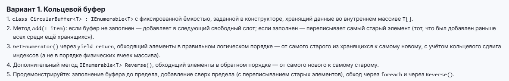
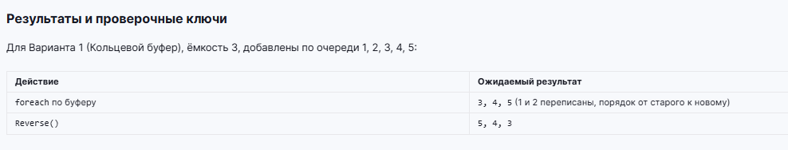
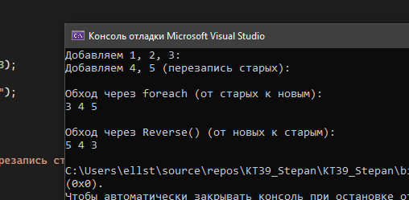

# КТ №39 - Пользовательские итераторы (Вариант 1: Кольцевой буфер)

Реализован класс `CircularBuffer<T>`, поддерживающий `foreach` через `IEnumerable<T>`. Логика обхода реализована через `yield return` без создания промежуточных списков. Добавлен альтернативный итератор `Reverse()`.

Задание:

Проверочные ключи:

Результат работы (вывод в консоль):
